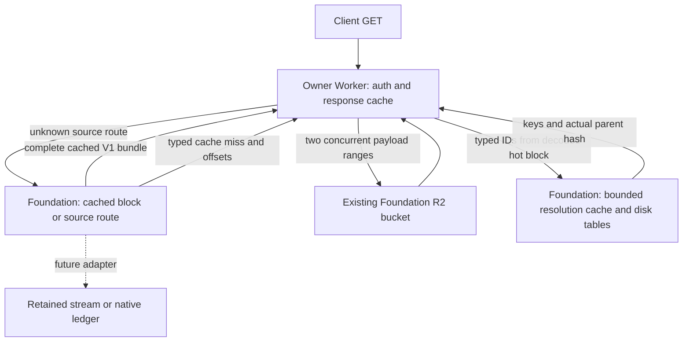

# Shared live and archive getBlock service

Date: 22 November 2026.
Status: recent Worker recovery is deployed. The sections below the current
implementation record describe earlier design options. They are historical
and do not authorize a new index, block store or RAM result cache.

## Current implementation

The public API is `https://getblock.blockzilla.dev` on the owner's Cloudflare
account. `GET /block/{slot}.compact` returns an exact retained native frame when
its expected source, Bank, blockhash and cursor match. The private Foundation
reader uses the existing rolling producer store in read-only mode. It adds no
block copy or per-block resolution index.

A verified finalized miss can use the original Foundation R2 archive ranges
and local Foundation ID resolution. An archive reply is an explicit Wincode
bundle. It does not claim a processed native cursor or control history.
Raw signatures remain in the original archive objects. Foundation result RAM
caching remains disabled. The admitted archive catalog covers twelve epochs;
this is not a claim of complete historical coverage.

The Rust input client recovers after a disconnect from its last committed
cursor. A finite metadata plan supplies exact ordered block identities and
original small control frames. Missing blocks come through the Worker. The
client checks frame/object hashes and source/Bank/parent identities, commits
each frame and cursor in one existing database transaction, then resumes raw
streaming from the fixed recovery target. Expired history stops explicitly.

The owner gives cost priority over extreme latency. Normal streaming makes no
Worker requests. No new result RAM cache, history-wide used-ID directory or
per-block disk index is part of this implementation. Current read counts and
cost limits are in the acceptance reports.

See [Worker and recent-reader acceptance](../../reports/recent-get-block-recovery-20261122/README.md)
and [automatic client recovery](../../reports/stream-worker-recovery-20261122/README.md).

## Historical design review

The remaining sections are the earlier review, before recent-first routing
and automatic Worker recovery were deployed. Their proposed future work and
RAM/index options are not the current owner direction.

## Current code and accepted service

The current accepted pipe is Foundation → Hetzner → Mac. Foundation sends its
original Compact V2 frames. Hetzner supplies SSE views for the client. The
accepted Hetzner disk image is bounded at 512 MiB; it is a replay buffer, not
an epoch index host. Firestrategy and Firewatch build their own application
indexes later. Webhook destinations remain empty.

Three existing readers can support one logical getBlock service:

| Source | Existing code | Current boundary |
| --- | --- | --- |
| Retained stream payload | `stream-relay/src/finalized_view.rs`, `bank_source.rs` | Exact finalized lookup in source; original `BZSTRM01` frame; retained native root required |
| Native recent ledger | `blockzilla-account-client::AccountClient::get_block` | Existing Blockstore, finalized only; storage-independent `LedgerBlock` with signed transactions and execution metadata |
| Historical Compact V2 | `ArchiveReader::read_finalized_block`, Worker resolution reader | Hash and actual parent checks; caller must admit the canonical archive generation |

The relay already declares
`GET /v2/banks/finalized/blocks/{slot:blockhash}`. In direct mode it checks the
source and retention authority before it reads a retained finalized block.
The finalized event feed has a different direct-mode limit; do not infer that
the exact-block route is disabled with it. Some finalized ancestors can be
available in replay before they have their own root catalog entry.

The accepted Hetzner sidecar API is SSE-only. It has no point-getBlock route.
The current Foundation connection uses restricted SSH and Unix sockets. The
public Worker cannot call that private pipe as HTTP. A separate authenticated
HTTPS broker or route is needed; no Foundation Worker deployment is required.

Sources: [current pipe](../../hivezilla/stream-sidecar/HETZNER-PIPE.md),
[relay contract](../../hivezilla/stream-relay/README.md),
the separately maintained native bridge, and
the separately maintained finalized archive reader.

## Common routing

Keep the public GET API and auth on the owner's Cloudflare account. Add a
separate native serving process beside Foundation storage, outside validator
callbacks and the raw stream path. Share reader/codec code; do not add a
second permanent recent-block archive.



The broker uses a coverage catalog to select the source. An old block that is
already published need not first fail both recent readers. For recent data,
try the retained compact payload, then the existing finalized ledger reader.
The ledger remains the overlap source until that block's R2 publication is
admitted. A missing local block is not proof that the slot was skipped.

For archive misses, use the current owner direction above. The earlier
one-hot-range design requires a new used-ID index and local signatures; neither
is part of this first implementation. Its latency has not been measured.

Cache immutable block/access results by genesis, slot, blockhash, admitted
commitment, format, schemas and source generation/content identity. Cached
payload bytes alone do not establish finality. A positive archive-coverage
record can have a long lifetime. Keep a short lifetime for availability misses
while a block is being built or published. Do not treat a native source change
as permission to reuse its old transport cursor.

## Shared identity and result contract

Use one logical identity within the API:

```text
BlockIdentity = genesis + slot + PoH blockhash
ParentIdentity = parent slot + actual previous PoH blockhash
Source = Native(session, Bank, host) | Archive(epoch, generation, object set)
Result = RetainedCompact | NativeLedger | ArchiveAccess | TypedUnavailable
```

The result also needs block height, requested/admitted commitment, schemas,
format and ID namespace. Archive access includes the exact hot range and
signature range, source lengths/strong ETags, resolution-content digest and
the block-local dictionaries. Bind the complete access body, not only the
range descriptor, before it enters shared caches.

Keep these identifiers distinct:

- Stream `BlockId` is slot plus PoH hash within a pinned genesis.
- Native `bank_id` identifies an execution Bank within its source.
- Archive `block_id` is a file-local ordinal.
- Vote bank hashes and vote block-ID hashes are separate hash families.

The actual previous hash is required, including at epoch boundaries and after
skipped slots. Never use `slot - 1` as its identity. Preserve the existing
genesis/slot-zero special case explicitly.

Typed unavailable results must preserve source change, pruned history,
incomplete metadata, not finalized, hash mismatch and unavailable coverage.
Transport failure is not a skipped-slot answer.

## Format adapters and shared code

`BZSTRM01` stream frames, native `LedgerBlock` JSON and
`BlockzillaGetBlockBundleV1` are different envelopes. Keep existing stream
consumers on their current bytes. Keep public `.bin` on its current V1
contract; do not relabel a stream frame as that bundle.

A retained one-Bank compact payload already carries its decode objects. Its
adapter can construct the V1 access data once and stream it beside the
existing hot frame. It needs no historical epoch resolution index. Native
ledger output currently supplies Base64 signed transactions and typed
execution metadata. A recent-block JSON adapter can reuse them, but a native
to Compact V2/V1 encoder still needs implementation and exact tests before
recent binary coverage can be claimed.

The same key can have different IDs in a live one-Bank registry and an epoch
registry. Repacking can therefore change compressed bytes and frame hashes.
Verify the same block, parent, ordered signed transactions and execution
metadata across the publication boundary; do not require equal envelope
hashes across distinct formats.

Extract a small transport-independent core from:

- `edgezilla/get-block/src/slot_resolution.rs`: locator, checked resolution,
  dictionary framing and validation.
- `edgezilla/get-block/src/bin/build_slot_resolution.rs`: the complete used-ID
  collector and membership checks.
- The shared signed-message codec, schema decode and actual parent-hash
  resolver. The Worker already shares the signed-message code by path.

Keep native disk, ledger, stream and Worker R2 adapters separate. Importing
the full synchronous native `ArchiveReader` into a Worker is not necessary.

## Disk resolution layout

For historical reads, keep the existing ID-to-value registries and the hot
index on disk. A later optional immutable slot-to-used-ID record could remove
the hot-decode dependency. It must cover message keys, address-table lookup keys,
loaded addresses, token fields, rewards, return-data and log keys, recent and
header hashes, and both vote hash families. An account-filter sidecar alone
does not cover complete getBlock reconstruction.

Store typed IDs, signature counts and a small descriptor, rather than a copy
of each resolved 32-byte key in every block record. Sorted delta/variable
length encoding is an option to measure later. The storage estimate uses raw
32-bit IDs and makes no compression-gain claim. Hash IDs can be signed.

If selected later, build these records during epoch compaction, when the final epoch IDs are
known. For old epochs, one bounded offline decode scan is required. Do not
put that scan or epoch packing in the live producer's critical path. Bind
each record directory to the exact source generation, schemas and registry
identities. A changed object set needs a new generation.

Signatures are separate. Read their original contiguous range in transaction
order. A service that returns raw signatures needs the original signature
file on local/shared storage or those bytes in cache. If it fetches missing
signatures from R2, count that GET too. Moving it behind Foundation does not
remove it from total origin reads.

Three capacity choices are useful:

| Host mode | Stored data | Total R2 reads for an uncached archive block |
| --- | --- | ---: |
| Tables and used IDs | Existing dictionaries plus new slot records | 2: hot and signatures |
| Tables, used IDs and local signatures | Above plus original `signatures.bin` | 1: hot |
| Complete local block/cache hit | Existing admitted block plus access | 0 |

Keep RAM caches bounded. A modern block in the sample uses 1,200–2,900 pubkey
IDs; one small network response can still require many registry-page reads.
Measure disk reads, bytes, cache misses, CPU, concurrency and host outbound
traffic. No latency win or all-in cost is established for this proposed
service.

## Publication and retention handoff

Use a durable per-block state transition:

```text
LOCAL_ONLY -> UPLOADED_UNADMITTED -> ARCHIVE_VERIFIED -> LOCAL_EVICTABLE
```

Admit only after source objects, lookup data, schemas, block identity, actual
parent, height and supported transaction/metadata semantics agree with the
trusted chain input. Query-upload receipts currently state
`canonical_publication=false`; file presence and matching HEAD lengths are
not this handoff. Missing rows are not skip proofs.

The native stream rolling window remains independent. Its retention authority
can expire stream replay, but cannot authorize pruning unpublished ledger
history. Keep ledger overlap until archive admission. A backfill client resumes
its next live transport cursor only after checked block/parent overlap; an
archive block ID cannot be substituted for a native SSE/beam cursor.

## Storage evidence and next implementation

Fresh epoch 1089/1090 metadata and the older 0–1047 inventory are recorded in
[the storage report](../../reports/stream-getblock-architecture-20261122/storage-estimate.md).
The current core tables are about 1.06–1.11 GB per recent epoch. The raw-ID
sidecar scenario adds about 4.02 GB per epoch, using only the four-block ID
sample. Local signatures add 10.8–12.2 GB per epoch. None of these figures
requires a second permanent compressed-block copy.

Implement in this order:

1. Extract common identity, reference collection and checked access codecs.
2. Build and verify one complete epoch's used-ID directory on offline input.
3. Add the native broker over retained stream, native ledger and archived
   access results, with an authenticated HTTP adapter.
4. Connect the owner Worker while preserving public GET/JSON/V1 contracts.
5. Test one exact block across live, ledger and archive sources, then epoch
   boundaries, forks, skipped slots, V0/V1, vote hashes and metadata edge cases.
6. Measure cold/hit paths, all origin GETs, disk load, CPU, RAM and bytes, using
   the same blocks and independent RPC references. Keep auth/startup separate.
7. Connect automatic coverage routing and ledger retirement only after those
   checks pass.

This review changes no validator, stream service, API deployment or R2 data.
