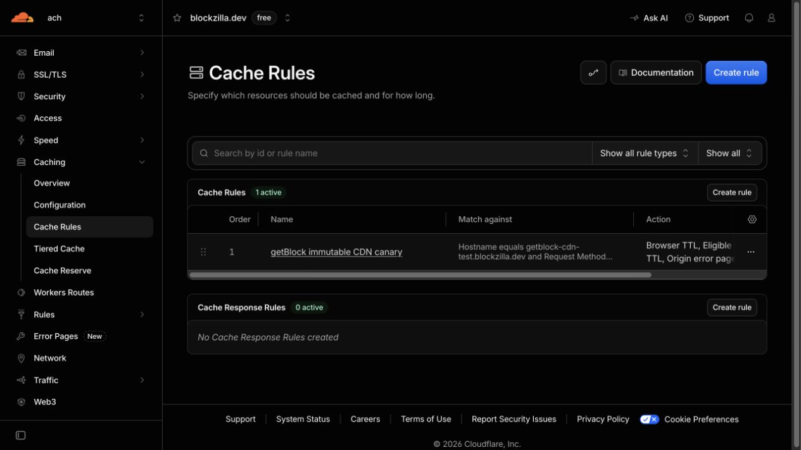

# Normal CDN cache test

The isolated Pages test served all 64 repeated block GETs from the normal
zone CDN, with zero observed getBlock Worker invocations. The main API still
uses its existing Worker custom domain. No production route was moved.

The test address is `https://getblock-cdn-test.blockzilla.dev`. Pages deployment
`85fdb391-70a1-444c-8131-72d9fe563476` calls the existing
`blockzilla-get-block` Worker through a service binding. Its only uploaded
asset is a small fallback page. The proxy transfers the original response
body stream. It uploads no block files and creates no new block index.

## HTTP policy and rule

Ordinary successful archived blocks already return:

```http
Cache-Control: public, max-age=31536000, immutable
```

The one-year TTL is a freshness limit. It does not reserve cache storage or
guarantee that Cloudflare will retain an object for a year. JSON requires an
eligibility rule; `.bin` is eligible by default. A rule alone does not move
the cache in front of the existing Worker custom domain. Pages provides the
separate zone-cache-before-Function path used here.

Rule `dae0be9b4a1d4578b0457e783d0003fb` applies only to the test hostname,
GET, `/block/` paths ending in `.json` or `.bin`, and an empty query string.
It sets eligibility, follows origin cache headers, bypasses when those headers
are absent, and respects browser TTL. No status-code TTL override is set.
Errors retain `no-store`. Query strings are not removed from cache identity.
The final exact expression and settings are in [summary.json](summary.json).

Before the rule was enabled, two identical JSON GETs returned `DYNAMIC` and
different random proxy invocation UUIDs. After it was enabled, JSON changed
from `MISS` to `HIT` and kept the same UUID. Upstream `CF-Cache-Status` and
`Age` are removed by the proxy, so the outer cache supplies these signals.

## Measured results

All eight blocks use the earlier benchmark slots, from two archive epochs.
There were 16 direct baseline GETs, 16 fill checks and 64 repeated hits.
All 96 block responses passed. Binary bytes and the JSON core matched the
independent earlier references. Full no-query bodies, including rewards,
matched the direct baseline. No block response bodies were saved to disk.

| Format | Verified CDN hits | Full body p50 | TTFB p50 | Observed getBlock invocations |
| --- | ---: | ---: | ---: | ---: |
| Wincode binary | 32 | 24.6 ms | 18.7 ms | 0 |
| Base64 JSON RPC | 32 | 77.8 ms | 20.6 ms | 0 |

These are sequential, persistent-connection HTTP/1.1 requests from this
client, with `Accept-Encoding: identity`. Timing ends before JSON validation.
JSON validation between requests is outside the latency measurements. Every
hit had outer `HIT`, an `Age` value, an unchanged proxy UUID and the exact
baseline body hash. All requests reached CDG. No cold R2 test was repeated.
The fill group contained 14 CDN misses and two previous CDN hits; its backend
caches were partly warm. It is not a fully cold read cohort.

The getBlock platform counters had 14/14 unsampled invocations for the miss
control and 2/2 for the earlier JSON control. They returned zero in both hit
windows, with exact and widened whole-second bounds. Pages' separate metric
dataset exposes the account-wide script name as `__unknown__`; project-level
positive controls are not visible. Therefore its empty project results are
not reported as measured zero Pages invocations. The frozen random UUID and
outer cache response show that proxy code was skipped.

The bounded HTTP run stopped at its 30-second guard after all 80 responses
passed, before its error phase. [http.json](http.json) keeps that failure flag.
A separate eight-request error/query check passed. The first four-request
error attempt is also retained. The final check verified six fresh, uncached
proxy rejections and two uncached platform `502` responses.

## Cost and production limit

For a normal CDN hit that skips Pages Functions, documented incremental
Worker request and CPU cost is **$0 per million hits**, with no origin R2
operation. A miss invokes the Function and the existing Worker. Under
Standard pricing, the service binding adds no second request fee; CPU across
both scripts is charged. Existing subscription, storage and Foundation host
costs remain separate. This is a pricing model, not an invoice.

**This prototype is not ready to replace the main API.** It accepts only
no-query JSON/bin GETs. Compact recovery, queries and authenticated methods
would need their original contracts preserved. Also, Pages replaces backend
JSON `502` responses with `error code: 502` text, without the proxy UUID.
Enabling the narrowly scoped origin error pass-through setting did not fix
that behavior. The errors remain `no-store`, with no `Age` or cache hit.
The report does not claim preserved JSON error bodies.

The user's slot `472608000` failure is a separate coverage gap, documented
in the [current-epoch diagnosis](../current-epoch-getblock-20261122/README.md).
This cache test did not repair that gap or change native services.

## Files and checks

| File | Purpose or check |
| --- | --- |
| `edgezilla/get-block/cdn-proxy/public/_worker.js` | Streaming proxy, fixed origin, per-invocation UUID, no-store guards; Node syntax and live binding checked |
| `edgezilla/get-block/cdn-proxy/public/404.html` | Small fallback asset; no block files uploaded |
| `edgezilla/get-block/cdn-proxy/wrangler.jsonc` | Pages service binding; actual Wrangler deployment passed after removing unsupported `account_id` |
| `edgezilla/get-block/cdn-proxy/README.md` | Deploy and manual verification instructions |
| [direct-baseline.json](direct-baseline.json) | 16 passed full block checks |
| [http.json](http.json) | All 80 block checks, including 64 verified hits; deadline flag preserved |
| [errors.json](errors.json) | Eight final rejection/error checks; JSON error limitation explicit |
| [platform-cpu.json](platform-cpu.json) | Read-only counter queries and sampling limits |
| [summary.json](summary.json) | Rule, deployment, timing and cost scope |
| [tools/bench.py](tools/bench.py) | Bounded HTTP checks; tracked reference hashes; no credential reads |
| [tools/collect_cpu.py](tools/collect_cpu.py) | Read-only platform counter capture; OAuth stays local |

To repeat a small test while the isolated hostname exists, run from the repo
root. Each output path must be new. The test has a hard 30-second limit.

```sh
python3 reports/cdn-cache-ttl-20261122/tools/bench.py --host getblock-cdn-test.blockzilla.dev --phase post --slots 2 --repetitions 2 --output /tmp/blockzilla-cdn-small.json
python3 reports/cdn-cache-ttl-20261122/tools/bench.py --host getblock-cdn-test.blockzilla.dev --phase errors --output /tmp/blockzilla-cdn-errors.json
```

The error check records the current synthetic-502 limitation. Its cache
policy result can pass while production JSON error compatibility stays false.

No broad Cargo build or CI work was done. The production Worker version
remained `4d1b4d55-31f1-4e30-a287-717846eeff3c`.

Sources: [Pages cache ordering](https://developers.cloudflare.com/pages/configuration/serving-pages/),
[Pages custom domains](https://developers.cloudflare.com/pages/configuration/custom-domains/),
[service bindings](https://developers.cloudflare.com/pages/functions/bindings/#service-bindings),
[Pages pricing](https://developers.cloudflare.com/pages/functions/pricing/),
[service-binding pricing](https://developers.cloudflare.com/workers/platform/pricing/#service-bindings),
[Cache Rule settings](https://developers.cloudflare.com/cache/how-to/cache-rules/settings/),
[default eligibility](https://developers.cloudflare.com/cache/concepts/default-cache-behavior/),
and [TTL versus retention](https://developers.cloudflare.com/cache/concepts/retention-vs-freshness/).


